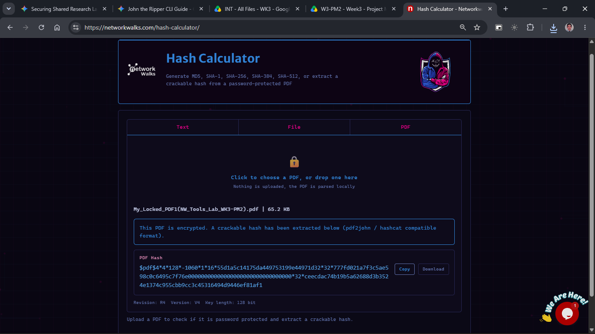
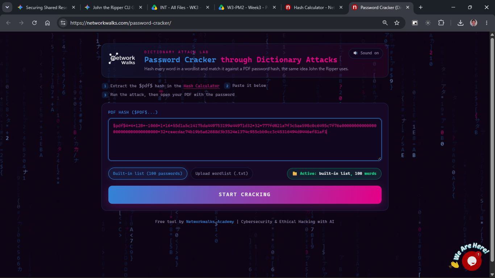
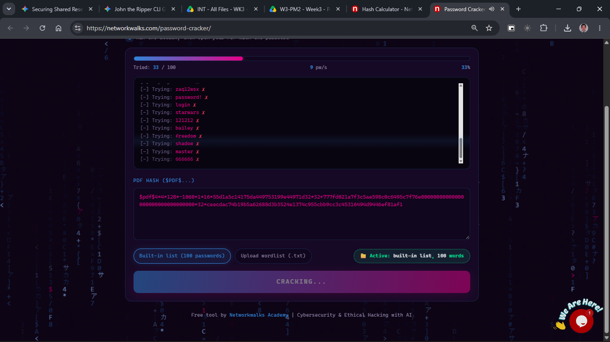
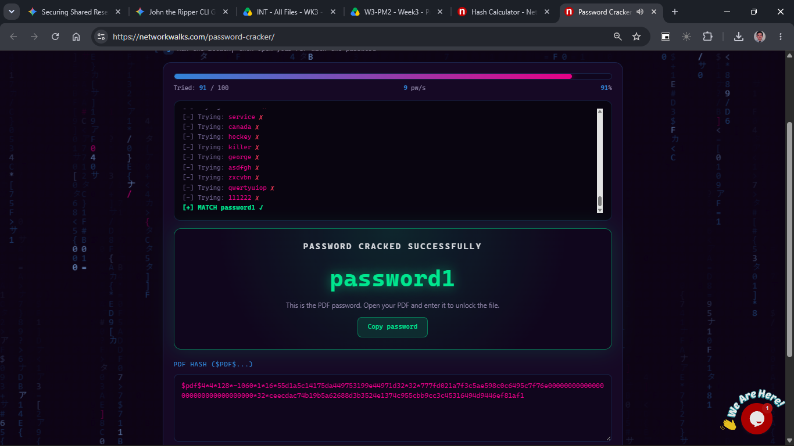
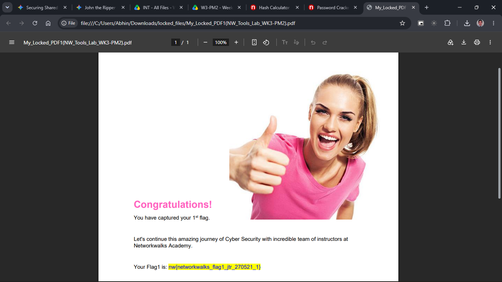
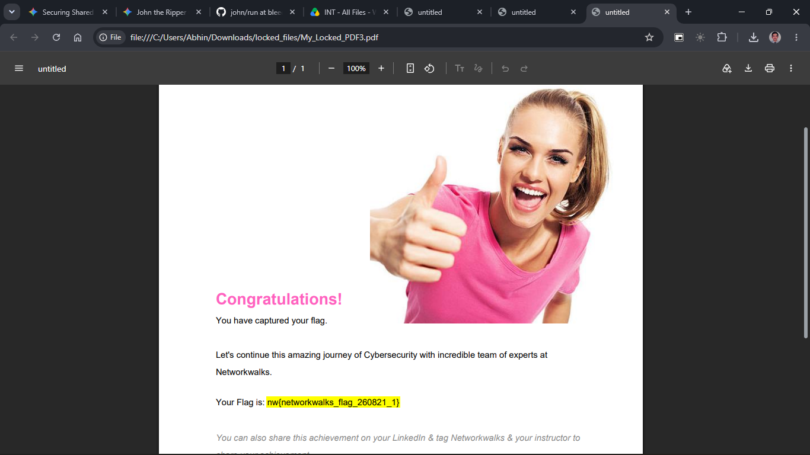
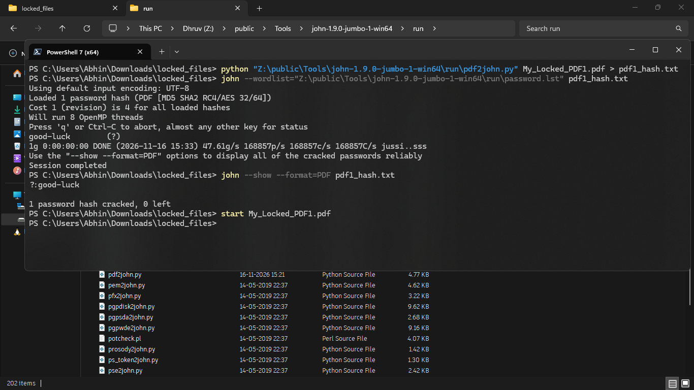
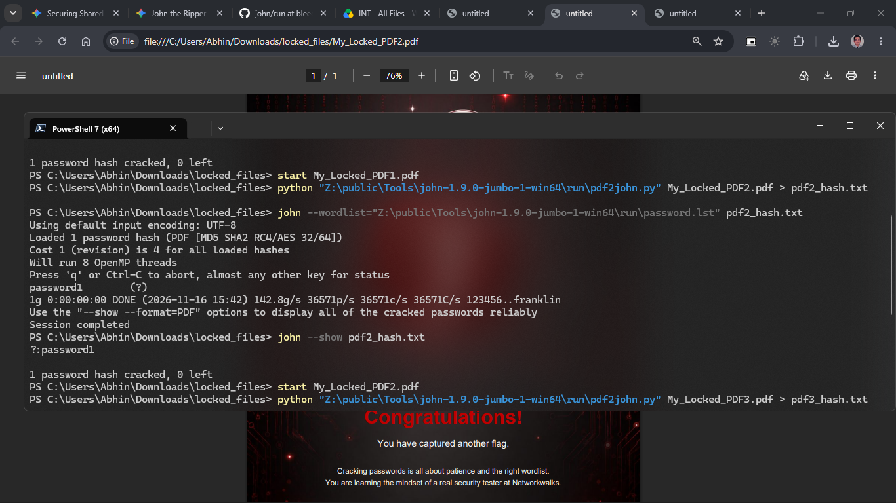
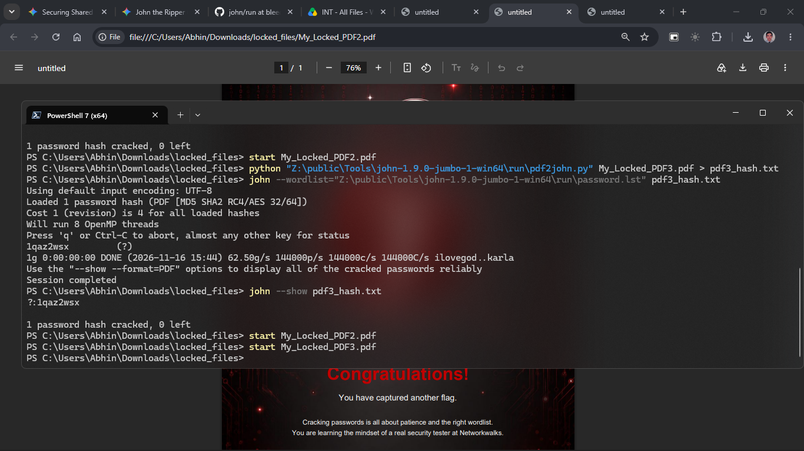

# Week 3 Lab: Hash Extraction & Password Cracking (John the Ripper)

This repository contains screenshot documentation and execution results from a cybersecurity lab focused on cryptographic hash extraction, PDF password protection analysis, and offline password auditing using **John the Ripper** and related cracking utilities.

---

## 🛠️ Tools & Concepts Covered

* **Tools:** John the Ripper (`john`), `pdf2john`, standard Linux CLI utilities.
* **Techniques:**
  * Extracting password hashes from encrypted PDF documents.
  * Identifying hash formats and encryption algorithms.
  * Performing dictionary and rule-based offline password attacks.
  * Auditing password complexity and demonstrating the risks of weak credentials.

---

## 📸 Lab Execution & Screenshots

### 1. Hash Identification & General Password Cracking

#### Target Hash Capture (`w3/hash.png`)
Initial hash generation, format identification, or target hash capture.

#### Cracker Setup & Configuration (`w3/cracker1.png`)
Initial setup and wordlist for the password cracker.

#### Active Cracking Execution (`w3/cracker2.png`)
Active cracking session progress and brute-force/dictionary attack execution.

#### Cracked Credentials Output (`w3/cracker3.png`)
Final cracked credentials output and session summary.

---

### 2. PDF Protection & Hash Extraction (`pdf2john`)

#### Password-Protected PDF Target (`w3/nw_pdf.png`)
Creation or inspection of a password-protected PDF target file.

#### Extracting PDF Hash (`w3/pdf1.png`)
Extracting the password hash from the protected PDF using `pdf2john`.

#### Verifying Extracted Hash Structure (`w3/pdf2.png`)
Verifying the extracted PDF hash structure and encoding.

#### PDF Encryption Metadata (`w3/pdf3.png`)
Additional PDF encryption metadata and security parameters.

---

### 3. Cracking PDF Passwords with John the Ripper

#### Running John the Ripper on PDF Hash (`w3/john_pdf1.png`)
Executing John the Ripper against the extracted PDF hash.

#### Monitoring Cracking Progress (`w3/john_pdf2.png`)
Monitoring John the Ripper cracking progress and wordlist matching.

#### Recovered PDF Password (`w3/john_pdf3.png`)
Successfully recovered PDF password (`john --show` output).

---

## ⚠️ Disclaimer

> **For Educational Purposes Only:** The techniques and tools documented in this repository were executed in a controlled lab environment for educational and defensive security auditing purposes. Always obtain explicit authorization before testing or auditing systems and files you do not own.
